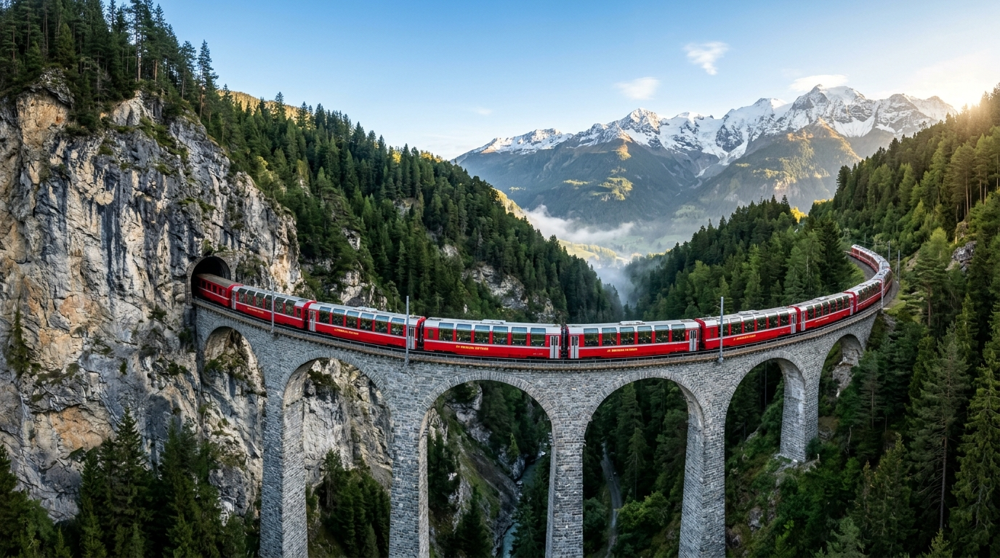
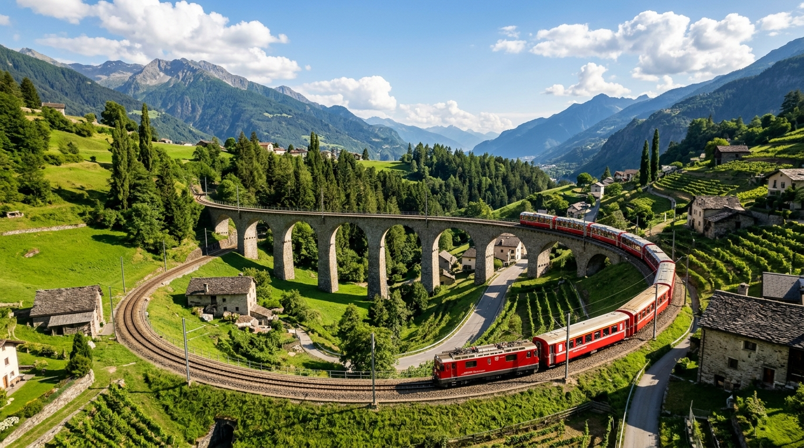

# Buzullardan Palmiyelere: Bernina Express ile Alplerin Kalbine Yolculuk

> *"Sabah Chur'un serin vadisinde başladığınız yolculukta, önce 2253 metredeki buzulların fırtınasını buğulu camdan izler; birkaç saat sonra İtalya'nın Tirano kasabasında palmiyelerin altında espresso yudumlarsınız. Bernina, raylar üstünde dört mevsimin tek bir güne sığdığı bir Alp mucizesidir."*

---

## 🗂️ Rota Pasaportu

| Bilgi | Detay |
| :--- | :--- |
| **Hat:** | Albula & Bernina Hatları (2008 UNESCO Dünya Mirası) |
| **Başlangıç - Bitiş:** | Chur (İsviçre) ➔ Tirano (İtalya) |
| **Toplam Mesafe:** | 144 km (55 Tünel, 196 Köprü ve Viyadük) |
| **Yolculuk Süresi:** | Yaklaşık 4 saat 15 dakika |
| **Zirve Noktası:** | Ospizio Bernina (2,253 m rakım — Avrupa'nın en yüksek dişlisiz tren geçidi) |
| **İdeal Koltuk:** | Chur'dan kalkışta **Sağ Taraf** (Landwasser ve buzul manzaraları) |
| **Mühendislik Harikası:** | Dişli çark mekanizması olmadan, saf sürtünmeyle yüzde 7'lik dik eğim tırmanışı |

---

## Peronda İlk Adım: İsviçre'nin En Eski Kentinden Zirvelere

Sabah saat 08.15... İsviçre'nin 5000 yıllık en eski kenti Chur'un tarihi garında serin bir dağ sisi hakimdi. Peronda beni bekleyen parlak kırmızı vagonlar, tavan eğimine kadar uzanan devasa panoramik pencereleriyle adeta gökyüzünü kompartımana davet ediyordu. Rhaetian Railway (RhB) görevlisinin düdüğüyle tren neredeyse fısıltı sessizliğinde süzülmeye başladı.

Vagonun içine adım attığımda temiz dağ havası, cilalı ahşap kaplamalar ve yolcuların heyecanlı fısıltıları beni karşıladı. Kırmızı tren, Ren Vadisi'nin yeşil çayırlarını geride bırakıp sarp Albula kanyonuna daldığında, dar hatlı (1000 mm) bu çelik mucizenin dağları nasıl dize getirdiğine şahit olmaya başladım.

*65 metre yükseklikteki Landwasser Viyadüğü'nden doğrudan dağın kalbindeki tünele giren kırmızı Bernina treni.*

---

## Durak Durak Alp Rüyası

### 1. Landwasser Viyadüğü ve Uçurumun Boşluğu (km 64)
Filisur mevkiine yaklaştığımızda hoparlörlerden hafif bir melodi yükseldi. Kırmızı lokomotif devasa bir yay çizerek **Landwasser Viyadüğü**'ne girdi. 1902 yılında hiçbir iskele kurulmadan, sadece iki vinç yardımıyla kireçtaşından örülen 65 metre yüksekliğindeki 6 kemerin üzerinde süzülürken altınızda hiçbir korkuluk veya zemin hissetmiyorsunuz; tren havada uçuyor ve viyadüğün bittiği milisaniyede dimdik bir kaya duvarının içine oyulmuş karanlık tünele dalıyor.

### 2. Albula Tüneli ve Preda - Bergün Kıvrımları
Tren vadi tabanından tünel girişine tırmanırken mühendislik tarihinin en şaşırtıcı spiral tünellerinden geçiyor. Tren dağın içinde 360 derece dönerek aynı köyü (Bergün) üç farklı irtifadan ve farklı açılardan selamlıyor. 5.8 kilometrelik tarihi Albula Tüneli'nden geçtiğimizde artık Engadin Vadisi'nin yüksek Alp dünyasındaydık.

### 3. Ospizio Bernina: 2253 Metrede Donmuş Zaman
Tırmanış devam ettikçe köknar ormanları yerini sarp kayalıklara, tundralara ve buzul göllerine bıraktı. **Ospizio Bernina İstasyonu**'na vardığımızda rakım tam 2,253 metreydi. Burası Avrupa'da normal trenlerin dişli ray olmadan çıktığı en yüksek irtifadır. Lago Bianco (Beyaz Göl) kıyısında durduğumuzda buzul rüzgarının camlara vuran tıkırtısı ve Cambrena Buzulu'nun mavimsi buz kütleleri nefes kesici bir sessizlik sunuyordu.

### 4. Alp Grüm: Sadece Trenle Ulaşılan Kartal Yuvası
Zirveyi aştıktan hemen sonra tren, sadece raylarla ulaşılabilen efsanevi **Alp Grüm** istasyonunda 15 dakikalık mola verdi. 2091 metredeki peronda durup güneye baktığınızda, yüzlerce metre aşağıdaki Poschiavo Vadisi ve ufuktaki İtalyan Alpleri ayaklarınızın altına seriliyor. İstasyon restoranının terasından tüten sıcak çikolata ve espresso kokusu dağ rüzgarına karışıyor.

### 5. Brusio Dairesel Viyadüğü: Mühendisliğin 360 Derecelik Valsı
İsviçre sınırını geçip İtalya'ya doğru dik inişe geçtiğimizde, demiryolu tarihinin en zarif çözümü belirdi: **Brusio Spiral Viyadüğü**. Tren çok dik dağ yamacından inerken rayların kaymaması ve frenlerin aşırı ısınmaması için vadinin ortasına 110 metre yarıçaplı dairesel bir viyadük inşa edilmiş. Kırmızı tren kendi vagonlarının altından geçerek 360 derecelik tam bir tur atıyor ve irtifayı zarafetle eriterek İtalyan topraklarına iniyor.

*Mühendislik mucizesi: 360 derecelik Brusio dairesel viyadüğünden süzülen kırmızı Bernina treni ve İtalyan vadisi.*

---

## 📜 Rayların Arkasındaki Tarih: Alpleri Delen İtalyan Taş Ustaları

Bernina hattı sadece bir mühendislik zaferi değil; insan iradesinin doğanın en sert kış şartlarına karşı verdiği 120 yıllık destansı bir mücadeledir.

19. yüzyıl sonlarında İsviçre kantonları kışın 6 ay boyunca dünyadan kopuyordu. Demiryolu mühendisi Friedrich Hennings önderliğinde başlatılan inşaatta, günde 12 saat buz gibi sularda ve göçük tehlikesi altında çalışan 1500'ü aşkın İtalyan taş ustası (*scalpellini*) görev aldı. Hiçbir harç veya yapıştırıcı kullanılmadan, granit blokların birbirine milimetrik oturtulmasıyla inşa edilen viyadükler, bugün 120 yıldır tek bir çatlak vermeden her gün binlerce tonluk trenleri sırtında taşımaktadır. Hat, 2008 yılında insan yaratıcılığı ve doğayla kurduğu kusursuz uyum sayesinde UNESCO Dünya Mirası Listesi'ne alınmıştır.

---

## 🧭 Gezginin Heybesi: Sahadan Pratik Tüyolar

1. **Hangi Koltuğu Seçmeli?**
   * Chur'dan Tirano yönüne giderken kesinlikle **SAĞ TARAFI (Right-hand side)** seçin. Landwasser Viyadüğü, Albula Kanyonu ve Palü Buzulu manzaraları sağ pencereden izlenir. Tirano'dan dönüşte ise sol taraf tercih edilmelidir.
2. **Fotoğrafçılık İpucu:**
   * Panoramik vagonların devasa camları dışarıdaki ışığı harika alır ancak yansıma yapar. En net ve lekesiz viyadük fotoğraflarını çekmek için vagonların geçiş körüklerindeki ve tuvalet önlerindeki **açılabilir küçük sürgülü camları** kullanın.
3. **Mola & Yerel Lezzetler:**
   * Alp Grüm'deki kısa molada yerel Grisons kuru eti (*Bündnerfleisch*) ve fındıklı cevizli İsviçre tartı (*Bündner Nusstorte*) atıştırın. Tirano'ya vardığınızda ise istasyon karşısındaki trattorialarda karabuğday makarnası (*Pizzoccheri*) ve Valtellina kırmızı şarabıyla yolculuğu taçlandırın.
4. **Bilet ve Rezervasyon Uyarısı:**
   * Bernina Express panoramik vagonları zorunlu koltuk rezervasyonu gerektirir. Yaz ve sonbahar aylarında yerler haftalar öncesinden dolduğu için RhB resmi sitesinden en az 1 ay önceden rezervasyon yaptırın.
