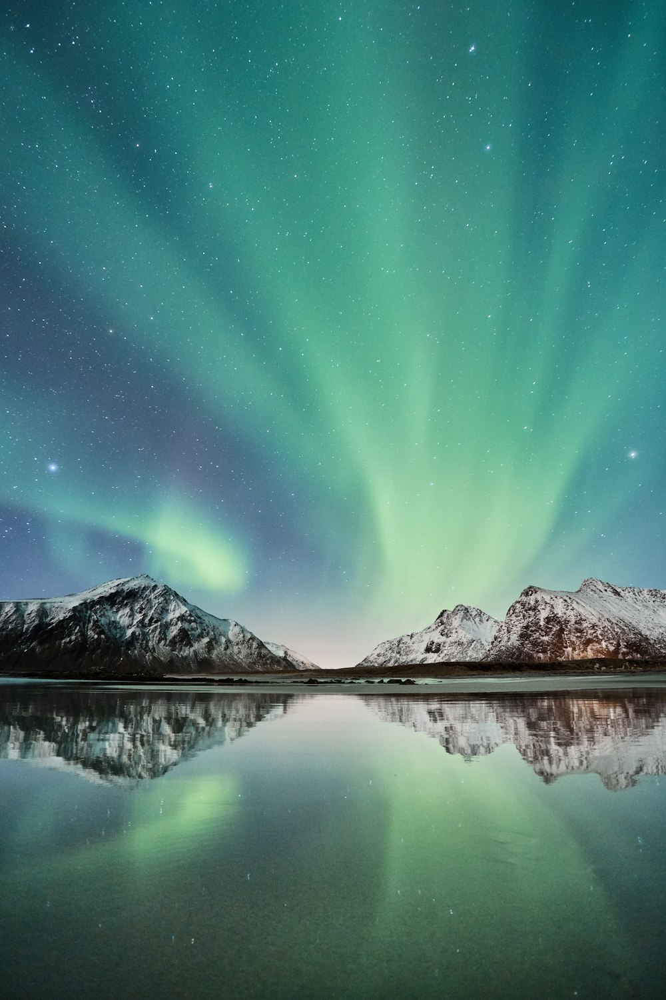

# Fiyortların Zirvesine: Flåm Demiryolu ile Norveç Masalı

> *"Aynamsı sularıyla Aurlandsfjord'un kıyısından hareket ettiğimizde, tren sanki fiyordun derinliklerinden gökyüzüne doğru bir ipe asılmış gibi tırmanmaya başladı. 20 kilometrede 866 metre irtifa farkı... Rayların kenarından fışkıran şelaleler ve puslu sisin içinde yankılanan Kelt-Nordik fısıltılar..."*

---

## 🗂️ Rota Pasaportu

| Bilgi | Detay |
| :--- | :--- |
| **Hat:** | Flåmsbana (Norveç Devlet Demiryolları - Vy) |
| **Başlangıç - Bitiş:** | Flåm Limanı (2 m rakım) ➔ Myrdal Zirvesi (866 m rakım) |
| **Toplam Mesafe:** | 20.2 km (20 Tünel, %5.5 Maksimum Eğim) |
| **Yolculuk Süresi:** | Yaklaşık 55 dakika |
| **Mühendislik Harikası:** | Normal ray aralığında dişli mekanizma kullanmadan dünyanın en dik demiryollarından biri (Her 18 metrede 1 metre tırmanış) |
| **İdeal Koltuk:** | Tırmanışta **Sağ Taraf** (Kjosfossen şelalesi ve vadi tabanı) |

---

## Peronda İlk Adım: Fiyordun Dingin Sularından Çıkış

Sabah saatlerinde Aurlandsfjord kıyısındaki Flåm ahşap iskelesinde dururken, fiyordun dik kireçtaşı duvarları bulutların arasında kayboluyordu. Yeşil renkli nostaljik Flåmsbana vagonlarına adım attığımda cilalı meşe paneller ve dev pencereler beni karşıladı. Lokomotifin kalkış düdüğü vadide yankılandı ve tren, fiyort kıyısını terk ederek dimdik bir dağ boğazının kalbine doğru tırmanışa geçti.

Pencereden dışarı baktığınızda aşağıdaki turkuaz renkli Flåm Nehri köpürerek akıyor, ahşap kırmızı Norveç çiftlik evleri dağ yamaçlarında minyatür gibi görünüyordu.

*Aurlandsfjord'un berrak sularından sarp vadilere doğru tırmanan yeşil Flåmsbana treni.*

---

## Durak Durak Fiyort Keşfi

### 1. Hareina ve Tarihi Ahşap Kilise (km 3)
Tren vadinin alt basamaklarında yükselirken 1667 yılından kalma geleneksel ahşap Flåm Kilisesi'nin yanından geçti. Yamaçlardaki elma bahçeleri ve otlayan koyunlar tipik bir İskandinav kırsal tablosu sunuyordu.

### 2. Rallarvegen: 19. Yüzyıl Madenci Patikası
Rayların hemen kenarında, 19. yüzyıl sonlarında demiryolunu inşa eden işçilerin (*rallar*) açtığı tarihi toprak patika kıvrılarak yükseliyordu. Bugün dünyanın en popüler bisiklet rotalarından biri olan bu patika, nehir yatağındaki asma köprülerle rayları kucaklıyor.

### 3. Kjosfossen Şelalesi ve Huldra Dansı (km 15.8)
Tren birden yavaşlayıp kükreyen **Kjosfossen Şelalesi** platformunda durdu. 5 dakikalık fotoğraf molası verildiğinde kapılar açıldı; yüzüme çarpan devasa su zerrecikleri ve 225 metreden dökülen şelalenin uğultusu kulakları doldurdu. Tam o sırada kayaların üzerinde, İskandinav mitolojisindeki orman perisi **Huldra**'yı canlandıran dansçının kırmızılar içindeki silueti vadide yankılanan büyüleyici bir ezgiyle belirdi.

*Kükreyen sularıyla Kjosfossen ve 866 metredeki zirve tünelleri.*

### 4. Berekvam ve Tek Hat Kesişimi
Flåm demiryolu tek hatlıdır; trenlerin karşılaşabildiği tek nokta Berekvam istasyonudur. Burada diğer dağ treniyle burun buruna geçiş yapılırken kondüktörlerin el sallaması demiryolu kardeşliğinin güzel bir geleneğidir.

### 5. Myrdal Zirvesi: Kar ve Buzulların Sınırı (866 m)
20 tünelin 18'i elle kazılmıştı. Tren son spiral tünelden çıkıp 866 metre rakımlı Myrdal Garı'na ulaştığında, fiyordun ılıman havası yerini dağların serin Alp rüzgarına bırakmıştı. Burası Oslo-Bergen ana hattının kesişim noktasıdır.

---

## 📜 Rayların Arkasındaki Tarih: İnsan Gücünün Doğa Karşısındaki Zaferi

Flåmsbana'nın inşası 1923 yılında başladı ve tam 20 yıl sürdü. Güzergahtaki 20 tünelden 18'i hiçbir iş makinesi olmadan, sadece işçilerin balyoz, kazma ve el dinamitleriyle dağları delmesiyle açıldı. Her 1 metrelik tünel kazısı ortalama 1 aylık insan emeğine mal oldu.

II. Dünya Savaşı sırasında Norveç'i işgal eden Alman ordusu, hattın stratejik önemini fark ederek elektrifikasyon çalışmalarını hızlandırdı ve 1944 yılında hat elektrikli lokomotiflerle tam teşekküllü hizmete girdi. Bugün Flåmsbana, dünyanın en güvenli ve en dik eğimli demiryolu mühendisliği anıtlarından biridir.

---

## 🧭 Gezginin Heybesi: Sahadan Pratik Tüyolar

1. **Hangi Koltuğu Seçmeli?**
   * Flåm'dan Myrdal yönüne tırmanırken **SAĞ TARAFTA (Right-hand side)** oturun. Kjosfossen Şelalesi platformu ve vadi tabanı sağ tarafta kalır. Myrdal'dan aşağı inişte ise sol tarafı tercih edin.
2. **Kjosfossen Fotoğraf Taktiği:**
   * Tren Kjosfossen'de sadece 5 dakika durur. Fotoğraf çekmek için anons yapılır yapılmaz kapıya yönelin; şelalenin su zerreciklerinden lensinizi korumak için mikrofiber bezinizi hazır bulundurun.
3. **Mola & Yerel Lezzetler:**
   * Flåm istasyonunda bulunan tarihi *Ægir Bira Fabrikası ve Restoranı*'nda Viking temalı ahşap salonda yerel somon ve tütsülenmiş geyik eti tadabilirsiniz.
4. **Bilet Uyarısı:**
   * Fiyort kruvaziyer gemilerinin yanaştığı günlerde biletler hızla tükenir. Norveç Demiryolları (Vy) üzerinden en az 2 hafta önceden yer ayırtın.
