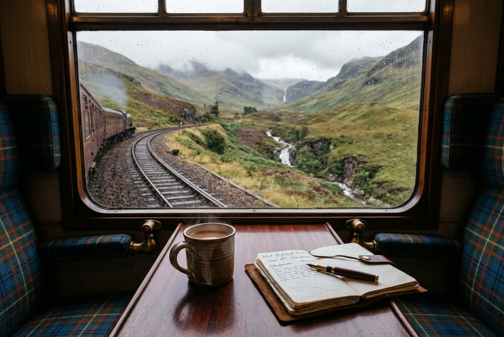
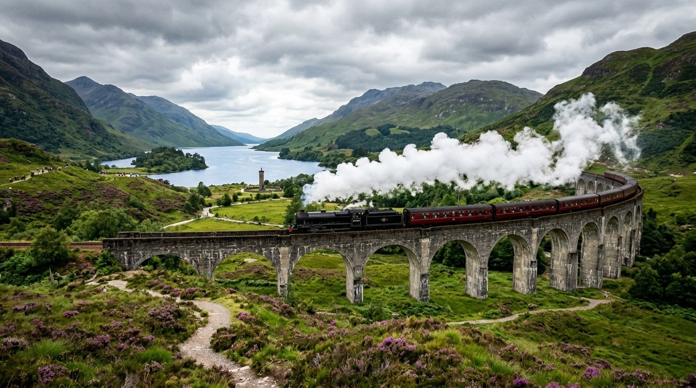
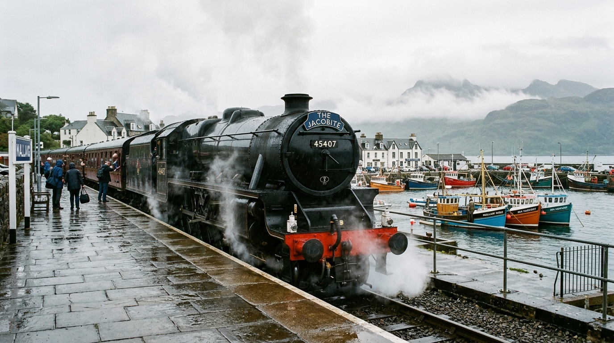

# Kuzeyin Dumanı: İskoç Dağlarında Jacobite Buharlı Treni ile Zamanda Yolculuk

> *"Lokomotifin kömür kokulu ilk nefesi peronu kapladığında, sadece İskoçya'nın batı kıyılarına doğru değil; klan savaşlarının, sürgün edilmiş prenslerin ve Viktorya dönemi demiryolu mucizelerinin tam kalbine doğru yola çıktığınızı anlarsınız."*

---

## 🗂️ Rota Pasaportu

| Bilgi | Detay |
| :--- | :--- |
| **Hat:** | West Highland Line — Mallaig Uzantısı |
| **Başlangıç - Bitiş:** | Fort William Garı ➔ Mallaig Limanı |
| **Toplam Mesafe:** | 42 mil (~67 km) her yön |
| **Yolculuk Süresi:** | Yaklaşık 2 saat 15 dakika (tek yön) |
| **İkonik Mühendislik:** | Glenfinnan Viyadüğü (21 Kemer, 30 m yükseklik) |
| **İdeal Koltuk:** | Fort William'dan kalkışta **Sol Taraf (A veya D cam kenarı)** |

---

## Peronda İlk Adım: Ben Nevis'in Gölgesinde Uyanış

Sabah saat 09.30 suları... Britanya'nın en yüksek zirvesi olan Ben Nevis, gri ve buğulu bir bulut tülünün ardında gizlenmişti. Fort William İstasyonu'nun nostaljik peronuna adım attığım an, kulaklarımı dolduran ilk şey devasa bir canlı gibi nefes alıp veren lokomotifin ritmik tıslaması oldu. Karşımda simsiyah gövdesi, pirinç armaları ve kırmızı vagonlarıyla efsanevi **LMS Stanier 'Black Five'** duruyordu.

Ahşap panelli Mark 1 vagonumun kapısını açıp ağır pirinç kolu çevirdim. Kompartımandaki ekose desenli yün kumaşların kokusu, yılların cilalı maununun rayhasıyla harmanlanmıştı. Kondüktörün gümüş düdüğü çaldı, buhar bulutları istasyon çatısını yaladı ve çelik tekerlekler ilk tok darbeyle raylara tutundu. 

LocoMotion günlüğümün bu sayfasını açarken, pencereye dökülen ilk yağmur damlaları manzarayı bir suluboya tablosuna dönüştürüyordu bile.

*Pencere kenarında sıcak bir Highland çayı ve yağmurla yıkanan İskoç bozkırları.*

---

## Durak Durak İskoçya'nın Vahşi Ruhu

### 1. Banavie ve Neptün'ün Merdiveni (Neptune's Staircase)
Yolculuğun henüz ilk çeyreğinde tren, Caledonian Kanalı'nı kucaklayan Banavie mevkiinden geçiyor. Thomas Telford'un 19. yüzyıl başlarında inşa ettiği ve ardışık 8 havuzdan oluşan efsanevi su merdiveni, dağların suyunu denize kavuşturuyor. Tren buradan kıvrılırken lokomotifin buharı kanal boyunca süzülen teknelerin direklerine karışıyor.

### 2. Glenfinnan ve 21 Kemerin Büyüsü
Tren Loch Eil'in sakin kıyılarını geride bırakıp dağların arasına tırmanmaya başladığında kompartımandaki herkes nefesini tutmuştu. Çünkü birazdan demiryolu tarihinin en dramatik kavisi belirecekti.

Lokomotif uzun bir zafer düdüğü çalarak sola doğru kıvrıldı. İşte oradaydı: **Glenfinnan Viyadüğü**. 

1897 ile 1901 yılları arasında demiryolu mühendisi *"Concrete Bob"* (Beton Bob lakaplı Sir Robert McAlpine) tarafından inşa edilen bu şaheser, hiçbir taş örgü veya çelik kafes kullanılmadan, tamamen **donatısız monolitik kütle betondan** dökülmüş 21 devasa kemerden oluşuyor. Vadinin tabanındaki Finnan Nehri'nden 30 metre yukarıda süzülürken tren adeta havada asılı kalıyor.

Pencereden dışarı sarktığınızda trenin kendi kıvrımını, vagonların arasından tüten kömür dumanını ve tam aşağıda uzanan esrarengiz **Loch Shiel** gölünü görüyorsunuz. Harry Potter filmlerindeki Hogwarts Express sahnesinin neden burada çekildiğini anlamak hiç zor değil; burası gerçek dünyayla efsanelerin sınırının silindiği bir coğrafya.

*21 kemerli Glenfinnan Viyadüğü'nden süzülen Jacobite ve uzakta pusuya yatan Loch Shiel.*

### 3. Arisaig: Britanya'nın En Batı Ucu
Glenfinnan'dan sonra tren vahşi meşe ormanları arasından geçerek Arisaig İstasyonu'na varıyor. Burası, Büyük Britanya ana karasındaki en batı demiryolu istasyonu unvanına sahip. İstasyon binasının ahşap sundurmasında asılı çiçekler ve serin okyanus rüzgarı, Atlantik kıyısına yaklaştığımızın ilk habercisi.

### 4. Morar ve Efsanelerin Beyaz Kumsalları
Raylar Loch Morar kıyısını takip ederken manzara bir kez daha kabuk değiştiriyor. 310 metrelik derinliğiyle Britanya'nın en derin tatlı su gölü olan Morar, yerel Kelt efsanelerinde *"Morag"* adında göl canavarına ev sahipliği yapar. Hemen birkaç dakika sonra ise masmavi Atlantik dalgalarının vurduğu, bembeyaz kumlarıyla ünlü **Silver Sands of Morar** (Morar Gümüş Kumsalları) selamlıyor bizi.

### 5. Son Durak: Mallaig'in İsli ve Tuzlu Limanı
Son tünelden çıkıp kıyıya indiğimizde önümüzde Mallaig Limanı açıldı. Burası yolun sonu; demir rayların bittiği ve açık deniz feribotlarının Skye Adası'na yolcu taşıdığı otantik bir balıkçı kasabası.

İstasyonda perona indiğimde yüzüme çarpan tuzlu okyanus meltemi ve lokomotif tekerleklerinin altından tüten hafif buhar, bu 67 kilometrelik epik yolculuğun en güzel vedasıydı.

*Yolculuğun son durağı: Atlantik kıyısındaki tarihi Mallaig balıkçı limanı.*

---

## 📜 Rayların Arkasındaki Tarih: "Bonnie Prince Charlie" ve İhanet Tepeleri

Jacobite treni sadece adını bir pazarlama fikrinden almaz; doğrudan üzerinden geçtiği toprakların kanlı ve asil tarihini taşır.

19 Ağustos 1745'te, sürgündeki Stuart Hanedanı'nın genç prensi **Charles Edward Stuart** (halk arasındaki adıyla *Bonnie Prince Charlie*), İskoç tacını geri almak için Fransa'dan gizlice yola çıkıp tam da viyadüğün gölgesindeki Glenfinnan kıyısına ayak bastı. Yanında sadece 7 yoldaşı vardı. Ancak İskoç klan liderleri Cameron ve MacDonald'lar gaydalar eşliğinde dağlardan inip sancağın altına girdiler. 1745 Jakobit İsyanı işte burada, Loch Shiel'in ucunda başladı.

İsyan aylar sonra Culloden Ovası'nda trajik bir bozgunla sonuçlandı; klanlar dağıtıldı, ekose kilt giymek yasaklandı ve İskoçya Yaylaları asırlar sürecek bir sessizliğe gömüldü. Bugün trenle o vadiyi geçerken tepede tek başına göğe yükselen **Glenfinnan Anıtı**, o gün canını feda eden Highland savaşçılarının anısına hala nöbet tutmaktadır.

---

## 🧭 Gezginin Heybesi: Sahadan Pratik Tüyolar

1. **Hangi Koltuğu Almalı?**
   * Fort William'dan kalkışta **SOL TARAFTA (Left-hand side)** oturduğunuzdan emin olun. Glenfinnan Viyadüğü kavisini, lokomotifin dumanını ve Loch Shiel manzarasını en iyi bu açıdan izler ve fotoğraflarsınız. Dönüş yolunda ise bu kez deniz manzaraları sağ tarafta kalacaktır.
2. **Fotoğrafçılık Tavsiyesi:**
   * Pencereler eski tip açılır sürgülere sahiptir. Viyadüğe 5 dakika kala fotoğraf makinenizi hazırlayın; lokomotif sola kıvrılırken pencereden dışarı taşmayacak şekilde geniş açılı bir lensle (24-70mm) hem viyadük kemerlerini hem de gölü kadraja alın.
3. **Mallaig'de 2 Saatlik Mola:**
   * Tren Mallaig'de dönüşten önce yaklaşık 1.5 - 2 saat bekler. Bu sürede hemen limandaki geleneksel balıkçılara uğrayıp meşe odununda tütsülenmiş ringa balığı (*Mallaig Kippers*) ya da taze İskoç midyesi tatmadan dönmeyin.
4. **Bilet Uyarısı:**
   * Jacobite, özellikle yaz aylarında aylar öncesinden tükenir. Biletinizi West Coast Railways üzerinden en az 3-4 ay önceden rezerve edin.
