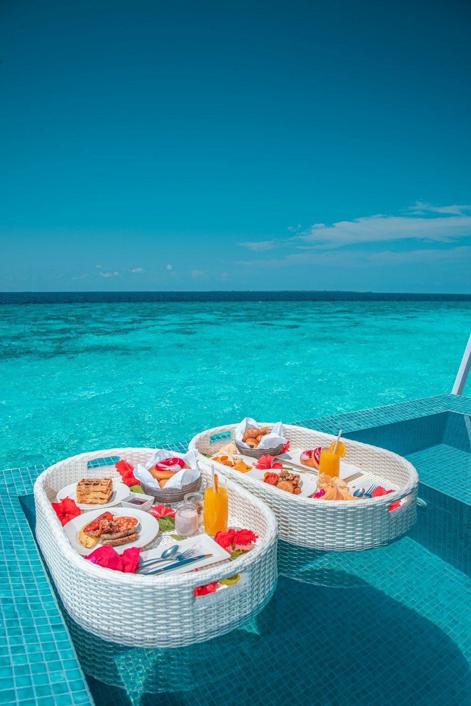
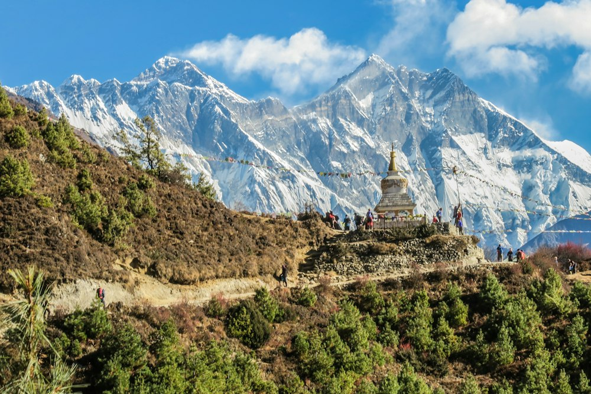

# Zümrüt Tepeler ve 9 Kemerli Köprü: Kandy - Ella Mavi Treni

> "Pencereleri ve kapıları ardına kadar açık mavi bir tren, Seylan çayı plantasyonlarının kokusu ve vadilerden süzülen muson sisi... Kandy'den Ella'ya uzanan bu hat, tren yolculuğunun saf neşe ve özgürlükle buluştuğu yerdir."

---

## 🗂️ Rota Pasaportu

| Bilgi | Detay |
| :--- | :--- |
| **Hat:** | Sri Lanka Main Highland Line |
| **Güzergah:** | Kandy ➔ Nuwara Eliya ➔ Demodara ➔ Ella |
| **Toplam Mesafe:** | 140 km (Ormanlar, Çay Tarlaları, Şelaleler) |
| **Seyahat Süresi:** | 6 - 7 Saat (Aheste ve Keyifli) |
| **İkonik Simge:** | Demodara Dokuz Kemerli Taş Köprü (Nine Arches Bridge) |

---

## Vagon Kapısında Oturarak Dünyayı İzlemek

Kandy peronunda mavi lokomotif belirdiğinde vagon kapısının basamağına oturdum. Tren hızlandıkça serin dağ esintisi yüzüme vurdu; rayların iki yanında rengarenk sarileriyle çay toplayan kadınlar trene el sallıyordu.

*Zümrüt yeşili çay tarlalarının arasından süzülen efsanevi mavi tren.*

---

## Dokuz Kemerli Köprü ve Ella Boğazı

Ella'ya yaklaştığımızda tren devasa bir kavis çizerek 1921 yapımı **Nine Arches Bridge**'e (Dokuz Kemerli Köprü) girdi. Tamamen taş ve tuğladan, tek bir çelik parça kullanılmadan inşa edilmiş bu viyadük tropik ormanın kalbinde masalsı bir köprü gibi uzanıyordu.

*Demodara vadisindeki tarihi 9 kemerli taş köprü.*