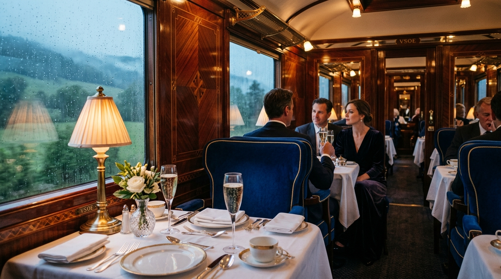
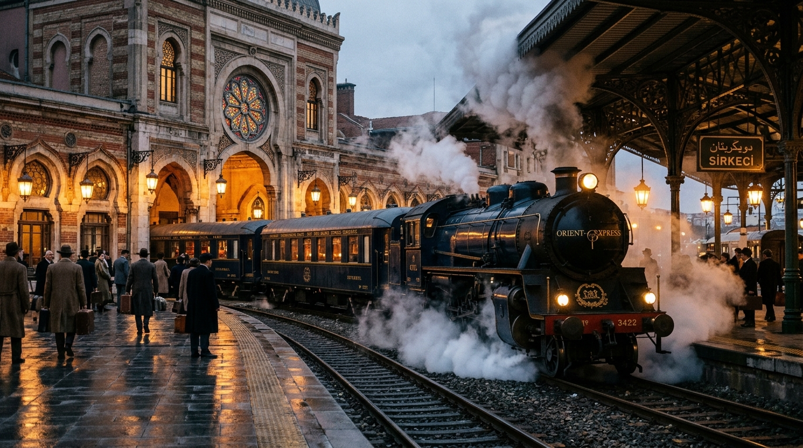

# Efsanelerin ve Casusların Rotası: Doğu Ekspresi ile Paris'ten İstanbul'a

> *"Kondüktörün frakındaki pirinç düğmeler, kristal kadehlerde çınlayan şampanya ve Paris'ten Boğaz'ın tuzlu sularına uzanan 3100 kilometrelik bir efsane... Orient Express bir ulaşım aracı değil; tarihin, entrikaların ve edebiyatın en şatafatlı sahnesidir."*

---

## 🗂️ Rota Pasaportu

| Bilgi | Detay |
| :--- | :--- |
| **Hat:** | Orijinal 1883 Orient Express Güzergahı |
| **Başlangıç - Bitiş:** | Paris Gare de l'Est ➔ İstanbul Sirkeci Garı |
| **Toplam Mesafe:** | ~3,100 km (Kıtalararası Lüks Rota) |
| **Yolculuk Süresi:** | 5 Gün / 4 Gece |
| **İkonik Vagon:** | 1920'ler Orijinal Lalique Kristalli 'Voiture-Restaurant' |
| **Tarihi Olay:** | 1929 Çerkezköy Kar Mahsur Kalışı & Agatha Christie Efsanesi |

---

## Paris'te Vals: Gare de l'Est'ten Uğurlanış

Paris'in tarihi Doğu Garı'nda (Gare de l'Est) perona adım attığımda, zaman 1920'lerde donup kalmış gibiydi. Gece mavisi ve altın sarısı işlemeli vagonların önünde beyaz eldivenli görevliler yolcuları selamlıyordu. Kompartımanıma girdiğimde cilalı tik ağacı kaplamalar, Fransız Lalique kristal aplikler ve pelüş kadife koltuklar beni karşıladı.

Tren hareket ettiğinde, kristal bardaklara dökülen şampanyanın tıkırtısı lokomotifin ilk tok ritmine karıştı.

*1920'lerin orijinal maun panelleri, kristal aplikleri ve nostaljik Art Deco kompartıman zarafeti.*

---

## Durak Durak Kıtaları Aşan Masal

### 1. Simplon Tüneli ve Venedik Suları
İsviçre Alpleri'ni delen 19.8 kilometrelik devasa Simplon Tüneli'nden geçtiğimizde gün yeni doğuyordu. Birkaç saat sonra tren Venedik lagünlerinin kıyısına yanaştı; Santa Lucia İstasyonu'nda gondolların gölgesinde verilen kısa bir mola, yolculuğun en romantik duraklarından biriydi.

### 2. Balkanların Gizemi ve Kar Fırtınaları
Venedik geride kalıp tren Budapeşte ve Bükreş ovalarına süzülürken kompartıman hayatı kendi küçük dünyasını kurmuştu. Akşam yemeğinde gümüş servislerle sunulan Fransız mutfağı ve piyano vagonundan yükselen caz ezgileri, dışarıdaki karanlık Doğu Avrupa gecesiyle büyüleyici bir tezat oluşturuyordu.

### 3. Tarihi Hadise: 1929 Çerkezköy Mahsur Kalışı
Tren Türkiye sınırına yaklaşırken aklıma Agatha Christie'nin ölümsüz romanı *Doğu Ekspresi'nde Cinayet* geldi. 1929 kışında Orient Express, İstanbul'a yalnızca 100 kilometre kala Çerkezköy yakınlarında devasa bir kar fırtınasına yakalanıp 6 gün boyunca mahsur kalmıştı. Eksi 25 derecede yolcuların vagon içinde hayatta kalma mücadelesi ve yaşanan esrarengiz olaylar, edebiyat tarihinin en büyük polisiye klasiğine ilham verdi.

### 4. Şarkın Kapısı: Sirkeci Garı'nda Görkemli Varış
Beş gün süren masal, Boğaz'ın kokusu ve minarelerin silueti belirdiğinde sona yaklaştı. Tren, Mimar Jachmund'un oryantalist şaheseri olan **Sirkeci Garı**'nın görkemli kemerleri altına süzüldüğünde perondaki pirinç fenerler geceyi aydınlatıyordu. 

Doğu Ekspresi'nden indiğinizde sadece bir trenden inmezsiniz; iki kıtanın ve asırların buluştuğu noktaya ayak basarsınız.

*Orient Express'in son durağı: Boğaz'ın kıyısındaki tarihi İstanbul Sirkeci Garı.*

---

## 🧭 Gezgin Tüyoları
1. **Kıyafet Kodu (Dress Code):** Akşam yemeklerinde smokin veya takım elbise geleneği halen sürdürülmektedir; bu atmosfere hazırlanarak katılmak deneyimi unutulmaz kılar.
2. **Pera Palas Bağlantısı:** İstanbul'a vardığınızda gezinizi tarihi Pera Palas Oteli'nde Agatha Christie'nin kaldığı 411 numaralı odada bir çay içerek taçlandırın.
