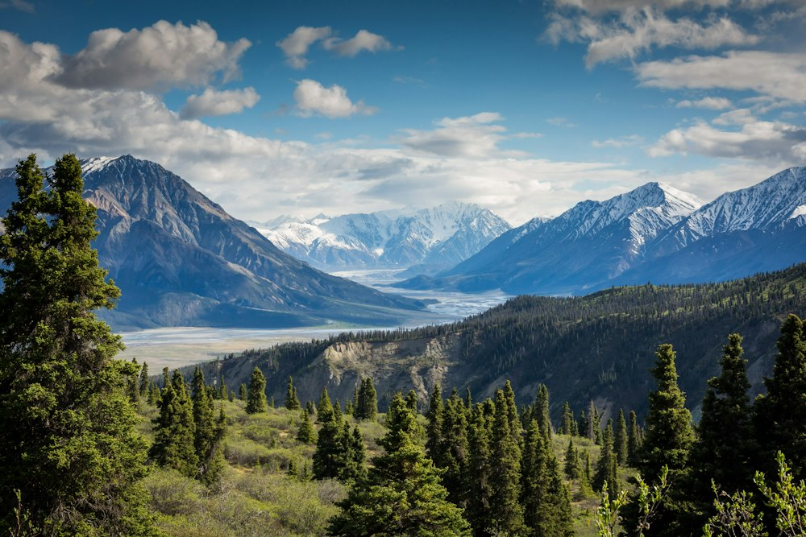

# Vahşi Batının Zirvesi: Rocky Mountaineer ile Kanada Kanyonları

> *"Cam kubbeli çift katlı vagonun tavanından göğe uzanan karlı zirveler, köpüren buzul nehirleri ve rayların birkaç metre ötesinde nehirde somon avlayan bozayılar... Rocky Mountaineer, Kuzey Amerika vahşi doğasının kalbine açılan en büyüleyici penceredir."*

---

## 🗂️ Rota Pasaportu

| Bilgi | Detay |
| :--- | :--- |
| **Hat:** | Tarihi Canadian Pacific Railway (CPR) Ana Hattı |
| **Başlangıç - Bitiş:** | Vancouver (Pasifik Kıyısı) ➔ Kamloops (Geceleme) ➔ Banff / Lake Louise |
| **Toplam Mesafe:** | ~900 km (2 Günlük Gündüz Seyahati — Geceleri otelde konaklama) |
| **Hizmet Sınıfı:** | GoldLeaf (Çift Katlı Cam Kubbeli Panoramik Vagon & Alt Kat Gurme Restoran) |
| **Mühendislik Harikası:** | Kicking Horse Geçidi'ndeki efsanevi Spiral Tüneller (Mount Ogden & Cathedral) |
| **Zirve Noktası:** | Continental Divide (Kıta Bölünmesi — 1,627 m rakım) |
| **Vahşi Yaşam:** | Bozayılar (Grizzly), kel kartallar, Kanada geyikleri (Elk) ve dağ keçileri |

---

## Peronda İlk Adım: Pasifik Kıyısından Çam Kokulu Zirvelere

Vancouver İstasyonu'nun peronunda sabah saat 07.00'de gayda melodileri eşliğinde kırmızı halıdan geçerek çift katlı GoldLeaf vagonumuza adım attık. Vagonun üst katına çıktığımda nefesim kesildi: Tavan tamamen bombeli camdan yapılmıştı ve 360 derecelik kesintisiz bir gökyüzü manzarası sunuyordu.

Kondüktörün "All aboard!" anonsuyla tren süzüldüğünde, alt kattaki gurme restorandan taze demlenmiş kahve ve sıcak tereyağlı kruvasan kokuları yükseliyordu. Tren Pasifik kıyısını geride bırakıp Fraser Vadisi'nin zümrüt yeşili ormanlarına daldı.

*Buzul gölleri ve Kanada Kayalık Dağları'nın heybetli kanyonları.*

---

## Durak Durak Vahşi Batı

### 1. Fraser Kanyonu ve Hell's Gate (Cehennem Kapısı)
Yolculuğun ilk gününde tren, Fraser Nehri'nin daralarak dakikada 750 milyon litre suyun köpürdüğü devasa bir yarığa dönüştüğü **Hell's Gate** kanyonuna girdi. Raylar nehrin hemen onlarca metre üzerindeki kaya balkonlarına asılmış gibiydi.

### 2. Kamloops ve Yarı-Çöl Bozkırları (1. Gün Sonu)
Tren yemyeşil yağmur ormanlarından çıkıp şaşırtıcı bir tezatla Thompson Nehri boyunca uzanan kurak, kanyonlu bir çöl platosuna girdi. Akşam saatlerinde ilk günün son durağı olan Kamloops kasabasına vardık ve geceyi yerel otelde geçirdik (Rocky Mountaineer gece seyahat etmez; hiçbir manzarayı karanlıkta kaçırmazsınız!).

### 3. Craigellachie: Kanada'yı Birleştiren Son Çivi (The Last Spike)
İkinci gün sabah erken saatlerde tren, 7 Kasım 1885'te Doğu ve Batı Kanada demiryollarının birleştiği tarihi Craigellachie noktasına vardı. Kanada'yı tek bir ulus haline getiren son altın kaplama çivinin çakıldığı anıt rayların hemen kenarında nöbet tutuyordu.

### 4. Spiral Tüneller: Dağın İçinde 360 Derecelik Kavis
Kicking Horse Geçidi'ne geldiğimizde mühendislik tarihinin en büyük zaferlerinden biri belirdi. %4.5'lik ölümcül eğimi aşmak için Mount Ogden ve Cathedral dağlarının kalbine kazılan iki devasa spiral tünelde tren kendi kuyruğunu izleyerek dağın içinden iki kat yukarıya tırmandı.

### 5. Continental Divide ve Banff Milli Parkı
1,627 metredeki Kıta Bölünmesi (Continental Divide) noktasını aştığımızda artık sular Pasifik yerine Atlantik Okyanusu'na akıyordu. Ufukta masmavi buzul gölleri ve Castle Dağı'nın karlı zirveleri belirdiğinde Banff Milli Parkı'nın kalbine ulaştık.

*Fraser Kanyonu ve köpüren buzul nehirlerinin kıyısında raylar.*

---

## 📜 Rayların Arkasındaki Tarih: Kanada'yı Kanada Yapan Demiryolu

1871 yılında British Columbia eyaleti, Kanada Konfederasyonu'na katılmak için tek bir şart koştu: 10 yıl içinde doğudaki Montreal'i batıdaki Pasifik Okyanusu'na bağlayacak bir transkontinental demiryolu inşa edilmesi. Aksi halde eyalet Amerika Birleşik Devletleri'ne katılacaktı.

Canadian Pacific Railway (CPR) projesi işte bu varoluşsal krizle doğdu. Kışın eksi 40 derecede sarp kayalıkları dinamitleyen, uçurumlara ahşap köprüler ören binlerce işçinin emeğiyle hat 1885'te tamamlandı ve Kanada tek parça bir ülke olarak tarihteki yerini aldı. Rocky Mountaineer bugün bu tarihi fethin en lüks mirasçısıdır.

---

## 🧭 Gezginin Heybesi: Sahadan Pratik Tüyolar

1. **GoldLeaf Açık Hava Balkonu:**
   * GoldLeaf sınıfında vagonun alt katında sadece birkaç yolcunun sığabildiği açık hava izleme vestibülü (outdoor viewing platform) bulunur. Rüzgarı yüzünüzde hissetmek, çam kokusunu solumak ve yansımasız vahşi doğa fotoğrafları çekmek için yolculuğun büyük kısmını burada geçirin.
2. **Vahşi Yaşamı Gözleme:**
   * Kondüktörler rayların kenarında bir bozayı veya geyik gördüğünde treni hafifçe yavaşlatır ve hoparlörden yön bildirir (Örn: "Saat 2 yönünde nehir kenarında anne ayı ve yavrusu"). Makinenizi teleobjektif (70-200mm) ile hazır tutun.
3. **Gurme Yemek Deneyimi:**
   * Vagonun alt katındaki restoranda ödüllü şefler tarafından hazırlanan Pasifik somonu, Alberta bifteği ve Okanagan Vadisi şaraplarıyla sunulan öğle yemekleri dünyanın en iyi tren menüleri arasında gösterilir.
4. **Bilet ve Sezon Tavsiyesi:**
   * Eylül sonu ve Ekim başı, dağ karaçamlarının (*Larch*) altın sarısına büründüğü ve zirvelere ilk karın düştüğü en dramatik dönemdir. Yerler aylar öncesinden dolduğu için 6 ay önceden rezervasyon yaptırın.
