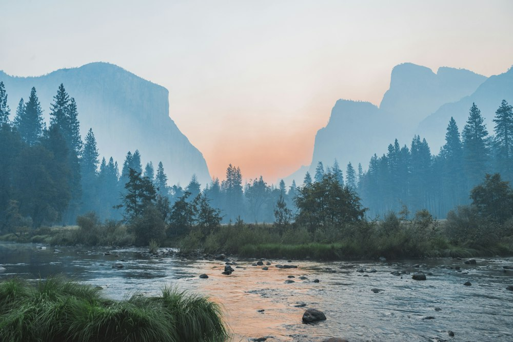

# Vahşi Batının Zirvesi: Rocky Mountaineer ile Kanada Kanyonları

> "Cam kubbeli çift katlı vagonun tavanından göğe uzanan karlı zirveler, köpüren buzul nehirleri ve rayların birkaç metre ötesinde nehirde somon avlayan bozayılar... Rocky Mountaineer, Kuzey Amerika vahşi doğasının kalbine açılan en büyüleyici penceredir."

---

## 🗂️ Rota Pasaportu

| Bilgi | Detay |
| :--- | :--- |
| **Hat:** | Rocky Mountaineer - First Passage to the West |
| **Güzergah:** | Vancouver ➔ Kamloops ➔ Continental Divide ➔ Banff |
| **Toplam Mesafe:** | ~900 km (Sadece Gündüz Çalışan Doğa Treni) |
| **Hizmet Sınıfı:** | GoldLeaf Cam Kubbeli Çift Katlı Panoramik Vagon |
| **Mühendislik Harikası:** | Kicking Horse Geçidi'ndeki Spiral Tüneller |

---

## Cam Kubbenin Altında Bozayılar ve Buzullar

Vancouver'dan ayrıldığımızda Fraser Kanyonu'nun cehennem kapısı yarığını geçtik. Tren hızını kestiğinde kondüktör anons etti: Nehir yatağında dev bir grizli ayı somon avlıyordu. Cam kubbeli tavandan bakarken başımızın üzerinden kel kartallar süzülüyordu.

*Buzul gölleri ve Kanada Kayalık Dağları'nın heybetli kanyonları.*

*Fraser Kanyonu ve köpüren buzul nehirlerinin kıyısında raylar.*