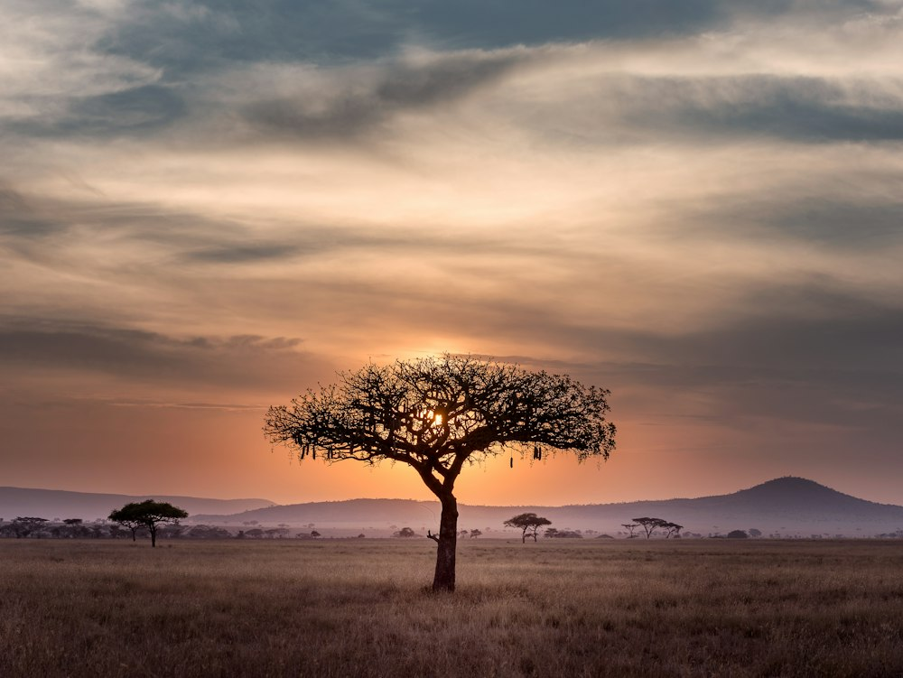
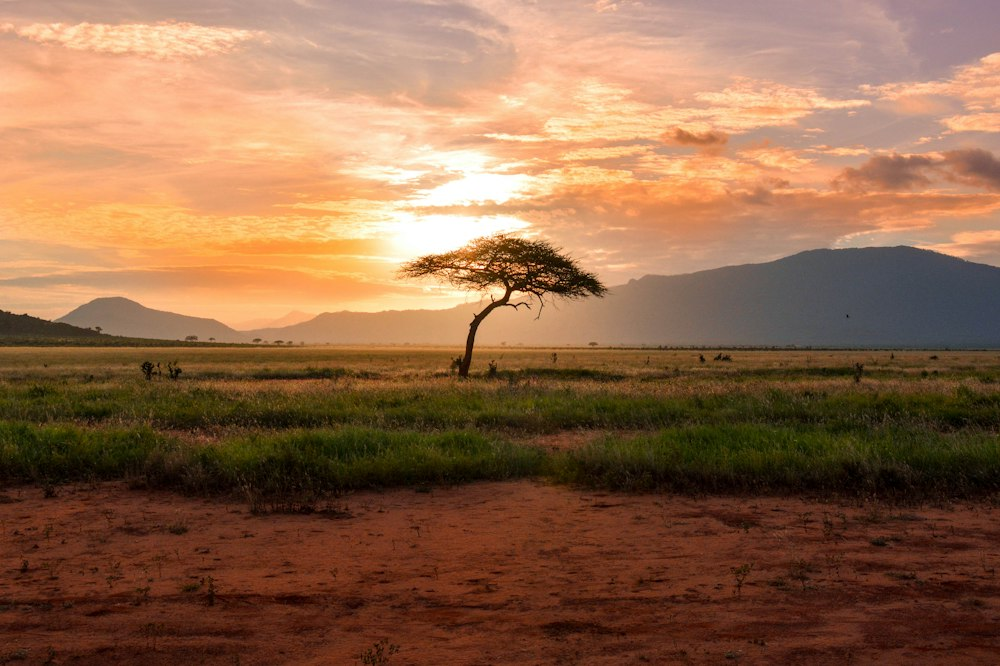

# Afrika'nın Gururu: Rovos Rail ile Savanada Zaman Yolculuğu

> "Pretoria'nın jakaranda ağaçlarıyla kaplı peronundan hareket eden Edward dönemi maun vagonlar, gümüş şamdanlar ve vagonun en arkasındaki açık hava balkonunda Afrika rüzgarını solumak... Rovos Rail, demiryolunun altından daha kıymetli olduğu çağların lüks vahasını yaşatır."

---

## 🗂️ Rota Pasaportu

| Bilgi | Detay |
| :--- | :--- |
| **Hat:** | Rovos Rail - The Pride of Africa |
| **Güzergah:** | Pretoria ➔ Kimberley ➔ Karoo Çölü ➔ Cape Town |
| **Toplam Mesafe:** | 1,600 km (3 Gün / 2 Gece) |
| **Kıyafet Kuralı:** | Akşam yemeklerinde smokin ve gece elbisesi (Zaman yolculuğu) |
| **Özel Vagon:** | Arkası tamamen açık 'Observation Car' ve geniş süitler |

---

## Vagonun Arkasındaki Açık Hava Balkonunda Gün Batımı

Akşamüstü saatlerinde tren Karoo Yarı-Çölü'nün kızıl topraklarında ilerlerken en arka vagondaki ahşap trabzanlı balkona çıktım. Kızıl güneş ufukta alçalırken uzakta antilop ve zebra sürüleri rayların kenarından hızla uzaklaşıyordu.

*Savanada asırlık Edward çağı nostaljisi ve Afrika gün batımı.*

*Karoo Çölü'nde altın sarısı gün batımı ve sonsuz savana.*