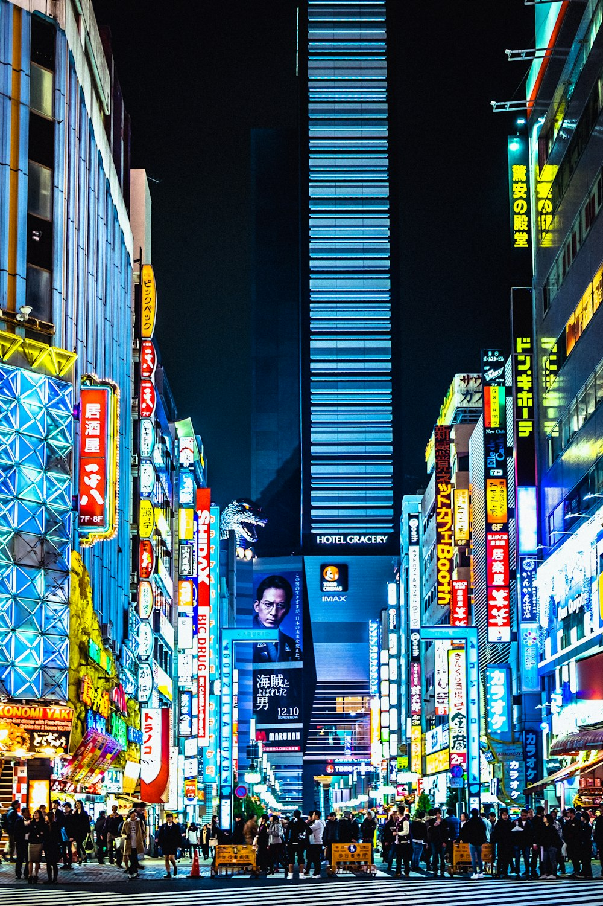
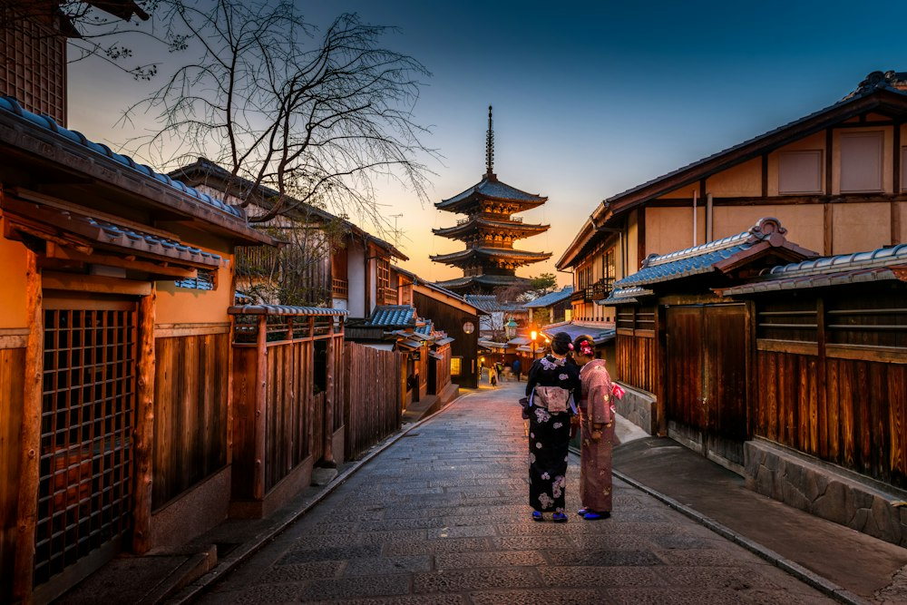

# Gece Güneşi: Sunrise Express ile Tokyo'dan Seto İç Denizi'ne

> "Tokyo'nun gece yarısı neon parıltıları geride kalırken, ahşap kokulu 'Nobi Nobi' tatami kompartımanında uzanıp pencereden kayıp giden istasyon ışıklarını izlemek... Sabah gözlerinizi açtığınızda ise Fuji Dağı'nın karlı silueti ve Seto İç Denizi'nin dingin dalgaları sizi karşılar."

---

## 🗂️ Rota Pasaportu

| Bilgi | Detay |
| :--- | :--- |
| **Hat:** | Sunrise Izumo & Seto (JR West) |
| **Güzergah:** | Tokyo İstasyonu ➔ Okayama (Ayrılış) ➔ Takamatsu & Izumoshi |
| **Toplam Mesafe:** | 953 km (Japonya'nın Tek Düzenli Gece Treni) |
| **Kalkış - Varış:** | 21:50 Tokyo ➔ 07:27 Takamatsu / 09:58 Izumoshi |
| **Kabin Tipleri:** | Nobi Nobi (Tatami Açık Yatak), Single Deluxe, Solo |

---

## Tokyo Garı'nda Gece Yarısı Ayrılışı

Saat 21.30 sularında Tokyo Garı'nın 9. peronunda bej ve bordo renkli 285 serisi EMU treni sessizce duruyordu. Kompartımana girdiğimde geleneksel Japon yukatası ve terlikleri hazırlanmıştı.

*Tokyo'nun gece ışıklarından kırsal Japonya'ya uzanan huzurlu raylar.*

---

## Okayama'da Ayrılış ve Büyük Seto Köprüsü

Sabah saat 06.30'da tren Okayama'da durdu ve ikiye ayrıldı: Bir yarısı tarihi Şinto tapınağı Izumo Taisha'ya giderken, bizim bindiğimiz Seto yarısı Shikoku Adası'na doğru Seto Ohashi asma köprüsünden denizin üzerinden geçti.

*Gündoğumunda sisler arasından beliren Fuji Dağı ve sabah yolculuğu.*