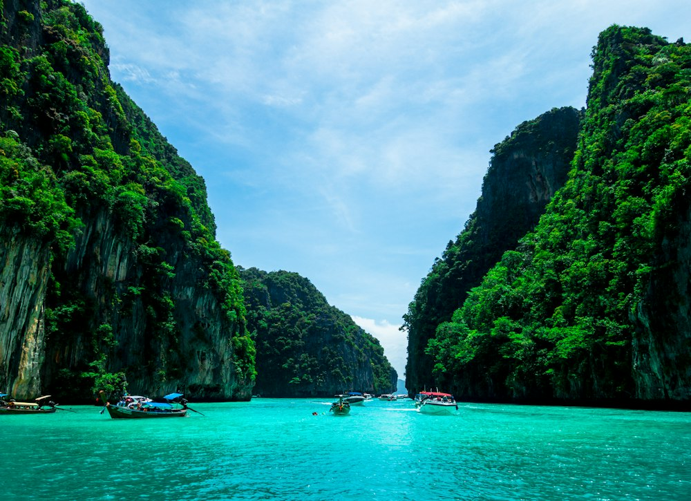
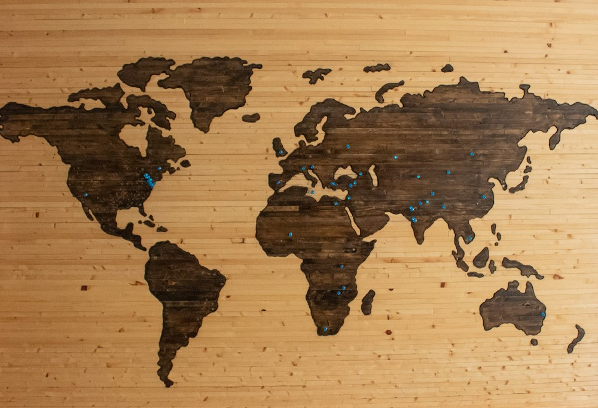

# Bulutların Treni: Tren a las Nubes ile And Dağları'nın Göğüne

> *"Salta Vadisi'nden yükselen tren, kaktüs tarlalarını ve derin kanyonları geride bırakıp 4,220 metreye tırmandığında altınızda raylar değil; sadece bulut denizi kalır. Tren a las Nubes, insanın gökyüzüyle kurduğu en cüretkar demiryolu köprüsüdür."*

---

## 🗂️ Rota Pasaportu

| Bilgi | Detay |
| :--- | :--- |
| **Hat:** | Ferrocarril General Manuel Belgrano — C-14 Şubesi |
| **Başlangıç - Bitiş:** | Salta İstasyonu (1,187 m) ➔ La Polvorilla Çelik Viyadüğü (4,220 m) |
| **Toplam Mesafe:** | 217 km tek yön (29 Köprü, 21 Tünel, 13 Viyadük, 2 Spiral) |
| **Zirve İrtifası:** | 4,220 Metre (Dünyanın en yüksek 3. demiryolu) |
| **Mühendislik İlkesi:** | Hiçbir dişli ray (*rack rail*) kullanılmadan sadece zikzaklar ve spirallerle irtifa kazanımı |
| **Özel Donanım:** | Vagonlarda taşınabilir medikal oksijen tüpleri, hemşire ve doktor kadrosu |

---

## Peronda İlk Adım: Kırmızı Topraklardan Göğe Tırmanış

Sabahın ilk ışıkları Salta'nın sömürge dönemi çan kulelerini kızıla boyarken gardaydım. Mavi-beyaz renkli heybetli dizel lokomotif derin homurtularla peronda nefes alıyordu. Kompartımana girdiğimde dağ rehberleri yolculara irtifa hastalığına (*soroche*) karşı koka yaprakları ve sıcak koka çayı (*mate de coca*) ikram ediyordu.

Kondüktörün düdüğüyle tren hareket ettiğinde, saniyeler içinde kentin banliyöleri geride kaldı ve And Dağları'nın devasa kırmızı kanyonları vagonları yuttu.

*And Dağları'nın kızıl kanyonları ve 4000 metredeki sonsuz plato.*

---

## Durak Durak And Dağları

### 1. Quebrada del Toro ve Dev Kaktüsler (km 40)
Tren Quebrada del Toro (Boğa Boğazı) kanyonuna girdiğinde, yamaçlarda boyu 10 metreyi bulan asırlık *Cardón* kaktüsleri belirdi. Nehir yatağını takip eden raylar, kızıl kaya yarıklarının içinden kıvrılarak yükseliyordu.

### 2. Chorrillos Zikzakları (İrtifa Fethi)
Eğim o kadar dikleşti ki trenin düz tırmanması imkansız hale geldi. Amerikalı mühendis Richard Maury'nin dehası burada devreye girdi: Tren bir kör hatta girip duruyor, makas değişiyor ve geri geri giderek dağın bir üst katına tırmanıyordu. Zikzaklarla irtifa fethedildikten sonra Puna Yaylası açıldı.

### 3. San Antonio de los Cobres Madenci Kasabası (km 196)
3,775 metre rakımdaki bu antik madenci kasabası, dünyanın en çetin coğrafyalarından birinde kurulmuştur. İstasyonda rengarenk lama yününden pançolar giymiş yerel Kolla yerlileri el emeği dokumalarını tren yolcularına sergiliyordu.

### 4. La Polvorilla Viyadüğü: 4220 Metrede Boşlukta Asılı Kalmak
Günün doruk noktası: 224 metre uzunluğunda, 64 metre yüksekliğinde ve tam 4,220 metre irtifadaki hilal biçimli devasa çelik viyadük! Tren viyadüğe girdiğinde pencereden aşağıya baktığınızda hiçbir zemin göremiyorsunuz; tren kelimenin tam anlamıyla bulutların üzerinde süzülüyor. Lokomotif viyadüğün ortasında durur, Arjantin milli marşı çalınır ve gökyüzünün sonsuz maviliğinde bayrak dalgalanır.

*4,220 metre rakımdaki efsanevi La Polvorilla çelik viyadüğü.*

---

## 📜 Rayların Arkasındaki Tarih: Richard Maury ve Andlar'ın Fethi

1921 yılında Arjantin hükümeti, And Dağları'nı aşıp Şili'nin Pasifik limanlarına ulaşacak bir demiryolu projesi başlattı. Projenin başına dahi mühendis **Richard Fontaine Maury** getirildi. 

Avrupalı mühendislerin "bu dağlar dişli ray olmadan aşılamaz" dediği coğrafyada Maury; hiçbir dişli ray mekanizması kullanmadan, trenin kendi sürtünmesiyle tırmanabileceği spiraller, viyadükler ve geri dönüş zikzakları tasarladı. 27 yıl süren inşaat boyunca dondurucu And gecelerinde yüzlerce işçi hayatını kaybetti. Maury öldüğünde vasiyeti üzerine kalbi, inşa ettiği demiryolunun hemen kenarındaki dağ yamacına gömüldü.

---

## 🧭 Gezginin Heybesi: Sahadan Pratik Tüyolar

1. **İrtifa Hastalığı (Soroche) Önlemleri:**
   * 4000 metrenin üzerinde oksijen seviyesi %40 düşer. Seyahatten önceki gün bol su için, ağır yemeklerden ve alkolden kaçının. Trende ikram edilen koka çayını yavaş yudumlarla tüketin; baş dönmesi hissederseniz vagon görevlilerinden hemen oksijen maskesi talep edin.
2. **Fotoğrafçılık Tavsiyesi:**
   * La Polvorilla viyadüğü hafif sola kavis çizer. Tren viyadüğe girerken sol pencereden lokomotifin çelik kemerlerin üzerindeki kavisini çekebilirsiniz.
3. **Mola & Yerel Alışveriş:**
   * San Antonio de los Cobres molasında yerel kadınların dokuduğu hakiki lama ve alpaka yününden eldiven, bere ve pançoları çok uygun fiyatlara satın alabilirsiniz.
4. **Bilet Uyarısı:**
   * Tren haftada sadece belirli günlerde çalışır ve kış aylarında yoğun talep görür. Biletinizi Tren a las Nubes resmi sitesinden en az 1 ay önceden ayırtın.
